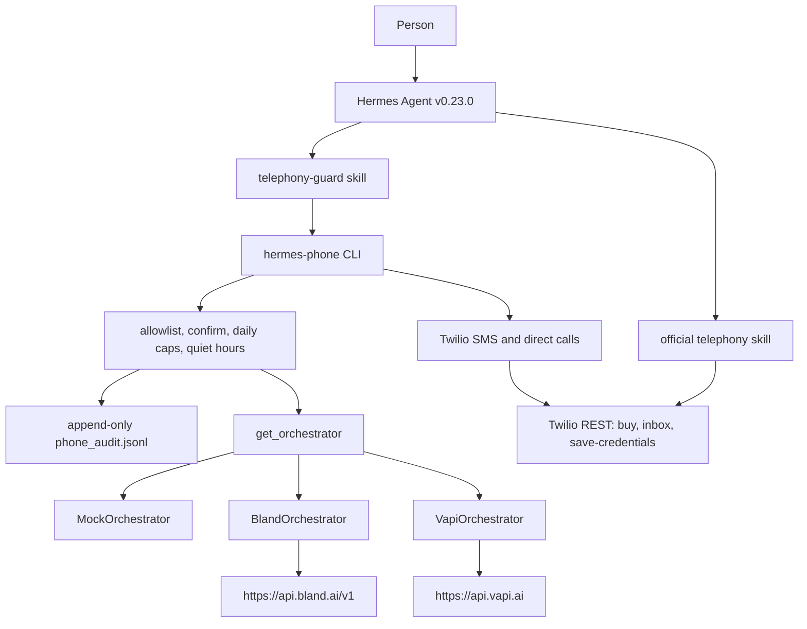

# hermes-phone-agent

Portfolio project by [Kevin Fairley](https://github.com/kfairy9999), a USMC veteran in Los Angeles looking for agentic-AI engineering roles.

This repo installs [Nous Research's Hermes Agent](https://github.com/NousResearch/hermes-agent) at a pinned release, installs the official optional telephony skill, and adds the pieces a real deployment needs: a guard in front of outbound SMS and calls, a mock provider that spends nothing, and pluggable Bland and Vapi adapters. Hermes itself is not forked. The voice-provider split follows the open design in [issue 66963](https://github.com/NousResearch/hermes-agent/issues/66963), which is not merged upstream.

The official skill is `hermes skills install official/productivity/telephony`. Its helper is `optional-skills/productivity/telephony/scripts/telephony.py`. Docs: [Telephony](https://hermes-agent.nousresearch.com/docs/user-guide/skills/optional/productivity/productivity-telephony).

## Consent, and whose account gets billed

Outbound AI voice calls in the United States need prior consent under the TCPA. Use this to call yourself or people who opted in. This README is not legal advice.

Twilio, Bland.ai, and Vapi each need their own paid account. A trial still has that vendor's rules and can still spend the trial balance. Mock mode, the default, contacts none of them.

## Architecture

Hermes stays the agent. The official skill remains the way to buy a number, save credentials, and poll inbound SMS. Outbound SMS and calls go through this wrapper. The wrapper checks the guard, writes a JSONL line, then calls one adapter.



`get_orchestrator()` picks `mock`, `bland`, or `vapi`. Selection order:

1. `--orchestrator`
2. `--provider`
3. `ORCHESTRATOR`
4. `PHONE_PROVIDER` (the variable `telephony.py` already reads)
5. `mock`

`ORCHESTRATOR=mock` blocks a live `--provider`. Going live means changing `ORCHESTRATOR` on purpose. Upstream `--provider` accepts only `bland` or `vapi`. This CLI adds `mock`.

## Quickstart in mock mode

Python 3.11 or newer. No API keys.

```bash
python3 -m venv .venv
source .venv/bin/activate
pip install -e ".[dev]"
pytest
python scripts/demo_mock.py
```

`pytest` runs the guard, the adapters against a fake HTTP stack, an end-to-end mock session, and, when `UPSTREAM_TELEPHONY_PY` points at the pinned `telephony.py`, a byte-level comparison of Bland, Vapi, and Twilio requests with that script.

The demo uses `/tmp/hermes-phone-demo` and does not read `~/.hermes`. It does three things:

1. You: "Text me a reminder at 5pm." The allowlisted fictional number `+13105550100` gets `Reminder: 5pm.` after a yes.
2. You ask for a call to `+12125550199`. That number is not on the allowlist. The guard refuses it even with `--confirm`.
3. A confirmed mock call returns a call id, then `ai-status` returns a canned transcript. The audit log has all four lines, and `vendor_spend_usd` is `0`.

Docker runs that same demo:

```bash
docker build -t hermes-phone-agent .
docker run --rm hermes-phone-agent
```

The image does not install Hermes. `scripts/setup.sh` does that on the host.

Recorded output: [docs/media/demo.txt](docs/media/demo.txt), [docs/media/demo.cast](docs/media/demo.cast) (asciinema v2), [docs/media/demo.gif](docs/media/demo.gif).

## Install Hermes and the telephony skill

`scripts/setup.sh` reads the pin in `UPSTREAM.json`:

| | |
| --- | --- |
| Tag | `v0.23.0` |
| Commit | `2bd378ed1b8d6bf2192cb26e0a55ff3091e6bd19` |
| Skill | `hermes skills install official/productivity/telephony --yes` |

The script downloads `scripts/install.sh` from that commit and runs it with the flags that installer documents: `--commit`, `--hermes-home`, `--non-interactive`, `--skip-browser`, `--skip-computer-use`. Browser and computer-use are skipped because this project does not use them. The checkout is checked against the commit before the skill install.

A fresh v0.23.0 install already writes `config.yaml`. On the install used to check this repo, `hermes config get model` returned `provider: auto`, `default: anthropic/claude-opus-4.6`, and `base_url: https://openrouter.ai/api/v1`. `scripts/setup.sh` then runs `hermes config set` (the real subcommand) to point that file at Groq:

```bash
hermes config set providers.groq.api "https://api.groq.com/openai/v1"
hermes config set providers.groq.key_env "GROQ_API_KEY"
hermes config set model.provider "custom:groq"
hermes config set model.default "qwen/qwen3.8-27b"
hermes config set model.base_url "https://api.groq.com/openai/v1"
```

`providers.groq.api` is the base URL from the [provider cookbook](https://hermes-agent.nousresearch.com/docs/integrations/providers). The named custom provider reads that `api` field (`hermes_cli/runtime_provider_custom.py`, `_entry_url`). `model.base_url` is set to the same Groq URL because the installer leaves OpenRouter there. The key stays `GROQ_API_KEY` in `~/.hermes/.env`. The cookbook's sample model is `llama-3.3-70b-versatile`; the model id here is `qwen/qwen3.8-27b`. Re-running setup sets the model back to this Groq pair. `hermes model` can change it later. The same five commands were run against the v0.23.0 checkout and `hermes config get model` showed the Groq values.

```bash
bash scripts/setup.sh
```

That also copies `skills/telephony-guard/` into `~/.hermes/skills/productivity/telephony-guard/` and creates an empty allowlist. Empty means every outbound number is refused.

## Go live

Do this only after the mock demo behaves the way you expect. Each vendor account is yours to create and pay for.

1. Create the accounts you will actually use.
   - Twilio, for a number, SMS, and direct calls: <https://www.twilio.com/try-twilio>
   - Bland, for the shortest path to an AI call: <https://app.bland.ai>
   - Vapi, for a higher-quality conversational voice on a Twilio number: <https://dashboard.vapi.ai>
2. Put keys in `~/.hermes/.env`. Start from `.env.example`. The official script reads `TWILIO_ACCOUNT_SID`, `TWILIO_AUTH_TOKEN`, `TWILIO_PHONE_NUMBER`, `TWILIO_PHONE_NUMBER_SID`, `BLAND_API_KEY`, `BLAND_DEFAULT_VOICE`, `VAPI_API_KEY`, `VAPI_PHONE_NUMBER_ID`, `VAPI_VOICE_PROVIDER`, `VAPI_VOICE_ID`, `VAPI_MODEL`, and `PHONE_PROVIDER`.
3. Save them with the official helper, which also writes `~/.hermes/.env`:

```bash
SCRIPT="$(find ~/.hermes/skills -path '*/telephony/scripts/telephony.py' -print -quit)"
python "$SCRIPT" save-twilio "$TWILIO_ACCOUNT_SID" "$TWILIO_AUTH_TOKEN"
python "$SCRIPT" save-bland "$BLAND_API_KEY" --voice mason
python "$SCRIPT" save-vapi "$VAPI_API_KEY"
```

4. Buy a number with the official script. This charges Twilio. This wrapper does not intercept it.

```bash
python "$SCRIPT" twilio-search --country US --area-code 213 --limit 5
python "$SCRIPT" twilio-buy "+1XXXXXXXXXX" --save-env
python "$SCRIPT" diagnose
```

5. For Vapi, import that number and store the id the API returns:

```bash
python "$SCRIPT" vapi-import-twilio --save-env
```

6. Add only numbers you may contact:

```bash
python -m hermes_phone allow-add +1XXXXXXXXXX
```

7. Leave `ORCHESTRATOR=mock` until you want to spend money. `save-bland` and `save-vapi` set `PHONE_PROVIDER` to `bland` or `vapi`, and the official script will then place a real call if you invoke it directly. This wrapper keeps ignoring that until `ORCHESTRATOR` is `bland` or `vapi`. Set both to the same value when you go live:

```bash
# ~/.hermes/.env
ORCHESTRATOR=bland
PHONE_PROVIDER=bland
```

8. Confirm each outbound action in chat, then pass `--confirm` for that exact command. The guard still applies the allowlist, quiet hours, and caps.

```bash
python -m hermes_phone twilio-send-sms "+1XXXXXXXXXX" "Deploy finished." --confirm
python -m hermes_phone ai-call "+1XXXXXXXXXX" "Ask for a Tuesday afternoon slot." --provider bland --max-duration 3 --confirm
python -m hermes_phone ai-status CALL_ID --provider bland
```

Vapi uses the same `ai-call` / `ai-status` commands with `--provider vapi`, after `VAPI_PHONE_NUMBER_ID` is set. `--max-duration` is minutes, as in the skill. The default is 3.

## Costs and limits

List prices below are what the vendors published around November 2026. They change, and they are not the whole bill.

| Item | Published base | What this repo does with it |
| --- | --- | --- |
| Twilio US SMS, long code | $0.0083 per segment ([Twilio SMS pricing](https://www.twilio.com/en-us/sms/pricing/us), October 2026) | Cap estimate uses `ceil(len(text) / 160)` segments. Real GSM-7 / UCS-2 segmentation can be higher. Carrier fees are extra (about $0.003 to $0.005 on major US carriers, same page). |
| Twilio US MMS outbound | $0.022 per message | Used when `--media-url` is set. |
| Twilio US outbound local voice | $0.0140 per minute ([Twilio voice pricing](https://www.twilio.com/en-us/voice/pricing/us), August 2026) | A direct `twilio-call` is estimated as one minute. A long call costs more than the cap reserved. |
| Twilio US local number | $1.15 per month on that voice page | Charged by Twilio when you buy. This wrapper does not cap `twilio-buy`. |
| Bland Start | $0.14 per minute ([Bland pricing](https://www.bland.ai/pricing)) | The cap commits `max_duration` minutes up front. Telephony is extra on Bland's page. |
| Vapi platform | $0.05 per minute | The cap uses the platform fee only. LLM, TTS, and the carrier are on top. A Vapi call can cost more than this cap thinks. |

Default caps, in `America/Los_Angeles`: 3 calls, 10 texts, and $2.00 of **estimate** per local day. Quiet hours default to 21:00–08:00 in that timezone, end exclusive, so 08:00 is allowed and 21:00 is not. The window is the operator's clock. It does not know the recipient's timezone, and it is not a TCPA time-of-day engine.

Mock attempts count toward the same caps, so a dry run exercises the limiter. The next local day starts a new count. The ledger is the JSONL file. It is append-only; this program never rewrites it.

Other limits, stated directly:

- `--confirm` on a command Hermes runs is an assertion by whoever has the shell. A model that can execute the CLI can pass the flag. The allowlist does not depend on the model telling the truth.
- The interactive prompt (`Type yes`) is the human step when a person is at the terminal. The answer has to be `yes`.
- Refusals are logged and do not consume the cap. A provider error after the guard has allowed the send does consume the cap, because the vendor may have accepted the request.
- The official skill does not answer inbound calls, and inbound SMS is polling, not a webhook. This repo does not add either.
- The wrapper sends SMS and direct calls from `TWILIO_PHONE_NUMBER`. The official script can also search the account for the only owned number. That lookup stays on `telephony.py`.
- US application-to-person SMS on Twilio long codes is subject to A2P 10DLC registration. The SMS pricing page says registration fees apply.
- Twilio trial accounts restrict who you can call and text. The skill's own pitfalls section says so.
- VoIP numbers are not reliable for every third-party 2FA flow. The skill says that too.
- Mock transcripts are canned. `ai-status` in mock mode returns that canned text.
- The POSIX audit lock is skipped on Windows, so two wrappers there can race the daily cap.
- `scripts/setup.sh` was written against the installer flags at commit `2bd378ed`. A newer installer on the public `install.sh` URL can differ; the setup script does not use that URL.

## Safety guard

Implemented in `hermes_phone.guard` and exposed as `python -m hermes_phone`.

- Allowlist of E.164 numbers. Default empty. File: `$HERMES_HOME/phone_allowlist.txt`, plus `PHONE_ALLOWLIST`.
- Confirmation before outbound SMS, direct calls, AI calls, and Vapi number import.
- Per-day caps on calls, texts, and estimated dollars.
- Quiet hours.
- Append-only JSONL log of every attempt and its result: `$HERMES_HOME/phone_audit.jsonl`. The log holds full numbers and message text. Keep it private.
- Emergency short codes (`911`, `988`, `112`, `999`, `000`) are refused.

The agent-facing instructions are `skills/telephony-guard/SKILL.md`.

## What I learned

The telephony skill is a Markdown procedure plus one stdlib Python script. Hermes does not grow a core phone tool. That keeps the agent small, and it means the safety text in the skill ("always confirm") is only followed if the model follows it. I put the check in a process that runs before any HTTP call.

Bland and Vapi are branched inside `_dispatch` in `telephony.py`. Issue 66963 asks for an `Orchestrator` with one adapter file per vendor so a new voice provider is a new file. I built that registry here, selected by `ORCHESTRATOR`, and left the upstream commands alone. The adapter tests load the pinned script and compare the HTTP request, so the wrapper cannot drift into an API I invented.

A dollar cap cannot be exact. None of the three call APIs return a quote before the call, Vapi's status `cost` arrives after the money is spent, and SMS has carrier fees the message API does not roll into the base rate. The cap commits a published base rate times the worst duration I already asked for. I would rather stop early than discover the invoice later. I also treat mock mode as the default, because the first time I have a live key is the wrong time to find out the allowlist is empty.

`PHONE_PROVIDER` defaults to `bland` inside the official script when it is unset. A wrapper that "uses the skill's provider variable" would place a Bland call by default. The dry run has to be an explicit `mock`, and it has to win over a `PHONE_PROVIDER` left behind by `save-bland`.

## How it was built

Kevin Fairley designed and directed this project and built it with AI coding agents. Hermes Agent is from Nous Research. The telephony skill and its HTTP calls are theirs, used here at the pinned v0.23.0 commit under their MIT license. The guard, mock provider, adapter package, tests, and demo are in this repository.

## License

[MIT](LICENSE), copyright 2026 Kevin Fairley. Hermes Agent is MIT, copyright Nous Research. This repository does not vendor Hermes source. The licenses can be used together: keep each project's copyright notice with that project's code.

## What was checked against Hermes v0.23.0

On 8 November 2026 the installer from commit `2bd378ed1b8d6bf2192cb26e0a55ff3091e6bd19` was run with `--commit` that SHA, `--non-interactive`, `--skip-browser`, and `--skip-computer-use`. `hermes --version` printed `Hermes Agent v0.23.0 (2026.9.24)` and `git rev-parse HEAD` matched the pin. `hermes skills install official/productivity/telephony --yes` installed `productivity/telephony`, and the installed `telephony.py` was byte-identical to the file at that tag. Copying `skills/telephony-guard/` into that home made `hermes skills list` show `telephony-guard` as a local enabled skill. `python telephony.py diagnose` with no provider keys reported `ai_call_provider: bland`, which is why this wrapper's default is an explicit `mock` rather than "whatever the script does when `PHONE_PROVIDER` is empty." The `hermes` command on that install is `python -I` (isolated). Shell commands from the agent use the user's `python3`, so `setup.sh` installs this package there.

`hermes config set` accepted the five Groq keys above on that same build. No live Groq, Twilio, Bland, or Vapi request was sent. Adapter tests compare HTTP with the pinned script through a fake `urlopen`. The demo and the rest of the tests stay in mock mode.

## Layout

```
src/hermes_phone/            wrapper, guard, Twilio client
src/hermes_phone/orchestrators/   mock, bland, vapi, get_orchestrator
skills/telephony-guard/SKILL.md   local Hermes skill
scripts/setup.sh             pinned Hermes install + skill install
scripts/demo_mock.py         three-beat mock demo
config/hermes.config.yaml    Groq OpenAI-compatible provider
UPSTREAM.json                tag, commit, docs URLs
```
